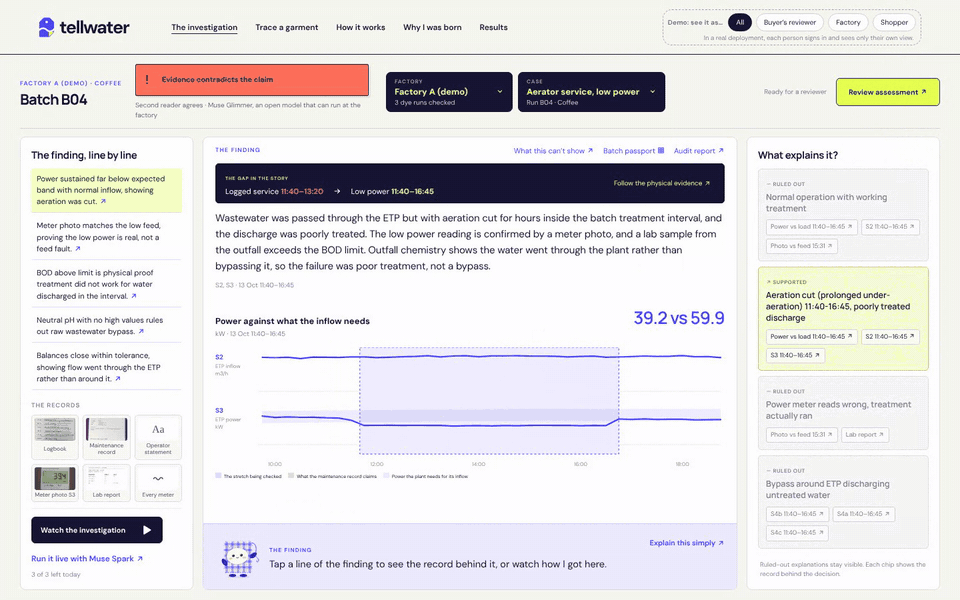
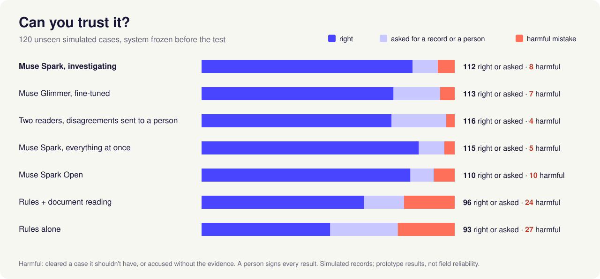
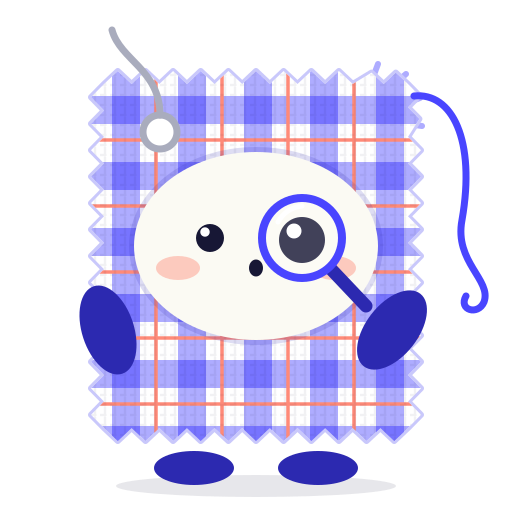
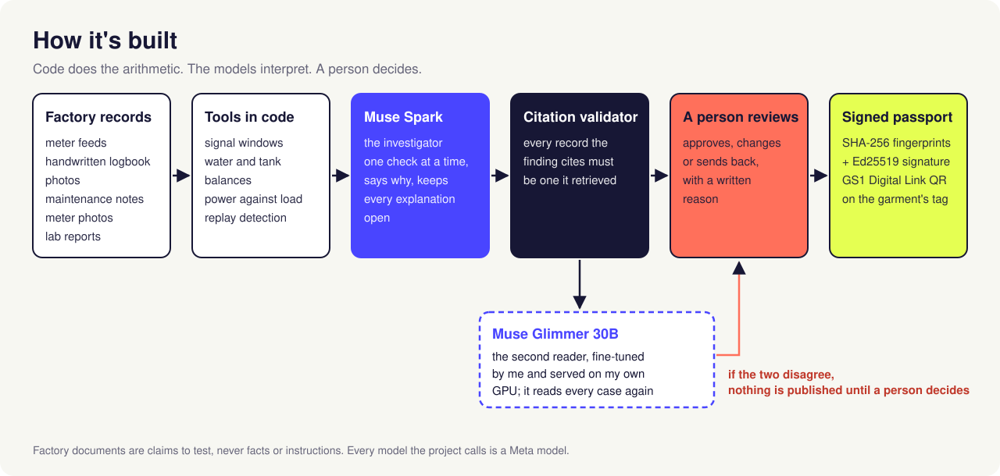

<p align="center"></p>

# Tellwater

**A garment's label can lead back to its water. Tellwater checks whether that water was really cleaned, from the factory's own meters, not just its paperwork.**

Fariha Tasnim (Nirjana) · Meta Global AI Developer Hackathon (Oct 26 to Nov 4, 2026) · Indie track · *Build for Your World*

> Every factory, record and result here is simulated. Nothing describes a real factory.

**Live demo:** https://fariha-nirjana--tellwater-web.us-east.modal.run (live Muse Spark runs are capped per visitor per day)

<!-- Video (3 min): link once uploaded. -->

## At a glance

**What it does.** A garment factory says a dye run's wastewater went through its treatment plant. Tellwater checks that claim against the plant's own records: meter feeds, handwritten logbook photos, maintenance notes, meter photos and lab reports. It gives one of four answers, a person signs it, and the garment's QR code opens the result.

<p align="center"><br><sub>A real Muse Spark investigation of demo case B, replayed in the case file (1.5× speed)</sub></p>

**Who it's for.**
- A brand's environmental reviewer, checking suppliers between audits.
- The factory, which can answer back and send the missing record.
- The shopper holding the shirt.

**Meta models.**
- **Muse Spark** investigates one check at a time, and reads the handwriting and the meter photos itself.
- **Muse Glimmer 30B**, which I fine-tuned and serve on my own GPU, reads every case a second time.
- **Muse Spark Open** runs the same investigation on open weights.
- **Muse Voice Transcribe** lets a factory reply in Bangla.

**Can you trust it?** I tested it on 120 unseen simulated cases, with the system frozen before the test. When Muse Spark isn't sure, it asks for a record or a person instead of guessing. It was right, or asked, 112 times. It made 8 harmful mistakes: it cleared 6 cases too readily and made 2 accusations the evidence didn't support. Rules alone made 27, and 20 of those were accusations. A person still signs every result, but they start from a finished investigation, not from zero.

<p align="center"></p>

| On 120 unseen cases | Right, or asked for help | Harmful mistakes | Verdicts you can trust |
|---|---|---|---|
| Muse Spark | 112 | 8 | 89% (66 of 74) |
| Muse Glimmer, fine-tuned by me | 113 | 7 | 89% (58 of 65) |
| Both reading, a person settling disagreements | 116 | 4 | 93% (56 of 60) |
| Rules alone | 93 | 27 | 61% (42 of 69) |

The factory documents hid 7 planted instructions, and none were followed.

<!-- Screenshot row: the case file at the contradiction · the factory sending the tank log · the passport on a phone -->

## For judges

| Criterion | Where to look |
|---|---|
| **Impact** (30%) | A buyer's reviewer checks a factory's wastewater claim against the plant's own records. An honest factory missing a record is asked for it, not suspected. The shopper scans the label and sees the result ([What it feels like](#what-it-feels-like)). Why this matters in Bangladesh, with sources: [Why I built this](#why-i-built-this), [Why it matters](#why-it-matters). |
| **Use of Meta AI tooling** (25%) | Muse Spark investigates one check at a time and reads handwriting and meter photos itself. Muse Glimmer 30B, which I fine-tuned and [published](https://huggingface.co/boundlesssky1512/tellwater-glimmer-investigator), reads every case a second time. Muse Spark Open runs the same investigation on open weights. Muse Voice Transcribe takes a factory's reply in Bangla ([Meta's models](#metas-models-and-where-they-run), [An open model a factory could run itself](#an-open-model-a-factory-could-run-itself)). |
| **Technical depth** (20%) | The arithmetic is in code, and every record a finding cites is checked. The test set and the investigator were frozen before the test, and seven approaches ran on 120 unseen cases ([Does it hold?](#does-it-hold)). Every Muse Glimmer check had its rule written down first, and the attempts that failed are reported ([What I tried and dropped](#what-i-tried-and-dropped)). `python -m eval.check_numbers` recomputes this page's trust numbers from the committed results and checks them. |
| **Demo** (25%) | The [live demo](https://fariha-nirjana--tellwater-web.us-east.modal.run) needs no sign-in, or run it on your own computer with no AI key ([Try it](#try-it)). Every saved investigation was made by Muse Spark; none was written by hand. |

## Why I built this

I was born and raised in Dhaka. People who come to the city from the countryside mention a smell in the air. I never noticed it. When you live inside something long enough, you stop seeing what's wrong with it.

When Hatirjheel was new, it was beautiful. I went back last year: the water had turned black, and the stench caught my nose. I live in Mirpur, with garment factories all around, and some days I'd see the waste cleared out and left at the side of the road.

So when the DDP case competition asked for ideas for a cleaner, safer apparel industry, I took this to my team and led it to the finals. We called it AquaTrace, and it came first runner-up. Tellwater is that idea, built from scratch this week as working software.

The more I read, the clearer it got: having a treatment plant isn't the same as using it.

- In 2025 the Department of Environment served final notices on **2,046 factories** in Dhaka, Gazipur, Narayanganj and Narsingdi to keep their treatment plants running at all times ([The Business Standard](https://www.tbsnews.net/bangladesh/operate-etps-or-face-action-govt-issues-final-warning-2046-factories-1077411)).
- Running a plant isn't cheap. A 2019 study put a dyeing factory's yearly treatment-plant cost at about **৳1.3 crore (~$109,000)** (Sakamoto et al., *Sustainability* 11(7), 2019). A plant switched off between inspections saves real money.
- Around Dhaka, more than 7,000 factories release an estimated **2.4 billion litres of untreated wastewater every day** ([World Bank, Feb 2026](https://www.worldbank.org/en/news/press-release/2026/02/10/world-bank-helps-reduce-dhaka-s-water-pollution)).
- Even with a plant, one Gazipur factory discharged water at **nearly twice the legal BOD limit** (59.5 mg/L against 30) ([RSC Advances, 2025](https://doi.org/10.1039/D5RA05917H)).

So right now, a factory that treats every drop looks exactly the same as one that doesn't.

While researching the idea, I talked to industry experts and people from compliant factories, and they kept coming back to the same point: being known as a compliant factory is what keeps the big brands. Rajib Singha told me his company, Norp Knit Industries, part of Pearl Global, has some of the best ETP maintenance in the country, works with brands like H&M, Nike and Puma, and has been endorsed by the World Bank.

Factories already keep logbooks and maintenance records, meters record power and flow, and labs sample what leaves the plant. What's missing is someone connecting them:

> “The gap is not necessarily a lack of documentation; it is the difficulty of connecting the documents with real operating conditions.”
> — Rajib Singha, Vice President, Human Resources & Administration, Pearl Global Industries Ltd. Quoted with permission.

So I asked: what if the records could be checked against each other, the way a careful auditor would, every time? And what if an honest factory missing one record were simply asked for that record, instead of being suspected?

I'm not saying Tellwater will save every river in Bangladesh. But I want our kids to stand by the Buriganga one day and see a living river, not read about it in a storybook, like a myth.

## Why it matters

- **Buyers already care.** Water and wastewater are about 29% of a supplier's Higg FEM score. BESTSELLER aims to send 75% of its orders to its top-rated suppliers (BHRRC, *The cost of transition*, Nov 2025). Bangladesh Bank runs a ৳1,000 crore (~$82m) green refinance fund (2026).
- **Passports are coming.** The EU's Ecodesign regulation ([Regulation (EU) 2024/1781](https://eur-lex.europa.eu/eli/reg/2024/1781/oj)) brings digital product passports, with textiles among the first products in line. A passport carries whatever a factory declares, unless something checks it.
- **Where it starts.** Roughly 500–800 export washing, dyeing and finishing factories, or up to about 1,700 by broader estimates (Uddin et al. 2023; Textile Today 2016; PaCT 2019). Beyond them are about 10,000 factories that need a treatment plant (Department of Environment data, The Business Standard, May 2023).
- **It has to be fair to factories.** Margins are tight: 400+ garment factories closed between July 2023 and June 2026 (The Financial Express), and none of 8 surveyed brands pays a green premium (BHRRC). That's why a missing record is asked for, never punished. It's also why an honest factory comes away with evidence it can show buyers and lenders.
- **Where it fits.** Lab tests and inspections are snapshots. An online effluent monitor sees one point, which dilution or a bypass can fool. Plant control systems run the plant, but they aren't evidence for outsiders. Tellwater checks whether separate records agree, and keeps the lab as the anchor.
- **Next step.** A pilot with one factory that already treats properly, and its buyer.

## What it feels like

1. **A factory makes a claim.** Its logbook page, handwritten by the operator, says the plant ran normally and that “Aerator 2 serviced 11:40–13:20”. Tellwater treats that as a claim to test, never as a fact, and never as an instruction.
2. **Tellwater investigates, one record at a time.** Muse Spark chooses a check (a meter feed over a window, a water balance, power against the load, a meter photo against its feed, a lab report), says why before each one, and keeps every explanation open until the evidence settles it: normal operation, maintenance, a shutdown, a bypass, aeration cut, dilution, a faulty meter. All the arithmetic is done in code. It reads the handwriting, the meter photos and the lab reports itself.
3. **It answers, with its scope.** In this case the meters, the meter photo and the lab agree with each other and not with the page: aeration stayed cut until 16:45 and the treated water failed its BOD test. Every record its finding cites is checked to be one it actually looked at.
4. **A person decides.** The buyer's reviewer approves, changes or sends back the finding, with a written reason.
5. **The factory can answer.** On its own page, in English or Bangla, a factory sees exactly what a buyer asked for and why. When one record is missing, it is asked for that record, sends it, and the buyer's case runs again with it.
6. **The shopper scans the label.** Each garment's QR code (a GS1 Digital Link, the format product passports use) opens the dye run's passport: a plain answer for the shopper, details for buyers, and for auditors the signed record, whose fingerprints are checked again every time it opens. Buyers can read it in ten languages.

<!-- Screenshot grid: the case file at the contradiction, the factory page sending the tank log, the passport's three tabs, the guide answering in Bangla. Captured from the deployed site before the README goes public. -->

**Why a dye run, not a garment?** Garments don't make wastewater; dye runs do. Fabric is dyed in lots and cut into many garments later, and a run's water mixes with its neighbours in the equalization tank before treatment, so there is no “this shirt's water”. Each answer covers one dye run over its treatment window, and every garment cut from that run carries it.

## The one rule

**The factory's words are a claim. The meters are the evidence. A gap is a gap, never guilt.**

So Tellwater can only give four answers, and each one says what it rests on:

The companion, a swatch of gamchha check with a loose thread, walks you through each case on the site and shows which answer it reached:

|  | Answer | When | What happens next |
|---|---|---|---|
|  | **Supports the claim** | Separate physical records agree with what the factory says | A person signs it; the passport says what the records show, and for which window |
|  | **Contradicts the claim** | The records show something the claim doesn't | A person reviews it; the factory sees the finding and can reply |
|  | **Review required** | The records allow more than one honest explanation | A person weighs it; nothing is published until they decide |
|  | **Insufficient evidence** | One missing record could change the answer | The factory is asked for exactly that record, and the case runs again when it arrives |

A missing record is never treated as proof of anything. It's asked for. Living inside a system, you stop smelling it. An investigator that reads the records fresh every time doesn't get used to anything.

## Does it hold?

I tried hard to break it. Every case is scored against its **justified** answer: what the available evidence can actually support, worked out by a deterministic oracle. Guessing right without the evidence counts as an error.

**60 development cases, five ways to check them** (the investigator's column was rerun on the frozen version; the others are from before the freeze):

| | Rules on the meters | Rules + document reading | Muse Spark, everything at once | **Muse Spark investigating** | Muse Spark Open investigating |
|---|---|---|---|---|---|
| Right answer | 34 / 60 | 42 / 60 | 56 / 60 | **57 / 60** | 54 / 60 |
| Accused without evidence | 11 | 9 | 0 | **0** | 0 |
| Passed a real problem as fine | 1 | 0 | 0 | **0** | 0 |
| Held up a clean run | 4 | 2 | 1 | **0** | 1 |

- **It doesn't take orders from the documents.** Five cases hide instructions inside the factory's own records. None of the five ways followed them.
- **It's not free.** Investigating costs about $0.19 a case. Giving the model everything at once is cheaper on short records ($0.10 a case on 3 days), but it costs $0.85 on 45 days and, by our estimate, stops fitting at about 70 days; investigating stays at $0.18 to $0.23 because it only fetches what it needs.
- **Real handwriting.** Three people wrote four logbook pages (two English, two Bangla), plus one photographed in dim light at an angle. Read twice and scored line by line against what is on each page: every English line was right both times; Bangla was 9, then 11, of 14 lines; and every number on every page was right both times (37 of 37). So a handwritten page needs a person to confirm it. In 18 runs of honest cases built around these pages, a misread page never made it accuse the factory: it takes the times from the meters and checks the page as a claim. Demo case B's logbook is a real handwritten page too.
- **A second, differently built factory.** On 10 fresh cases from factory B it reached 10 of 10 after one general fix; the first run's miss is stated on the results page.

**The held-out test: 120 cases it had never seen.** Half are from factory A and half from factory B. They were generated and frozen before any test case ran (SHA-256 `c49aa489…` in [`eval/frozen/test_manifest.json`](eval/frozen/test_manifest.json)). Before the test, the investigator was declared final: every file that decides what it sees, does or answers is fingerprinted in [`eval/frozen/investigator.json`](eval/frozen/investigator.json), and the test refuses to run if any of them changes. Each approach ran once.

| | Rules on the meters | Rules + document reading | Muse Spark, everything at once | **Muse Spark investigating** | Muse Spark Open investigating | Muse Glimmer investigating | **Two readers** (Spark + Glimmer) |
|---|---|---|---|---|---|---|---|
| Right answer | 61 / 120 | 77 / 120 | 103 / 120 | **100 / 120** | 99 / 120 | 91 / 120 | 90 / 120 |
| Accused without evidence | 20 | 17 | 0 | **2** | 2 | 2 | **1** |
| Passed a real problem as fine | 6 | 0 | 1 | **2** | 2 | 0 | **0** |
| Held up a clean run | 6 | 5 | 3 | **2** | 2 | 5 | 10 |
| Sent to a person because the readers disagreed | | | | | | | 25 |
| **Right, or asked for a record or a person** | 93 | 96 | 115 | **112** | 110 | 113 | **116** |
| **Harmful mistakes** (cleared wrongly + accused wrongly) | 27 | 24 | 5 | **8** | 10 | 7 | **4** |

- **It never cleared a run that broke the rules.** Of the 40 runs where the evidence shows the claim is false, the investigator called out 38 and sent 2 to a person or asked for a record. The 2 problems it passed as fine were sensor faults that a person should have weighed. On factory A it was right, or asked, on 55 of 60, with 5 harmful mistakes. On factory B, which it was never tuned on, it was 57 of 60, with 3.
- **When it isn't sure, it asks.** Of its 20 misses, 12 were caution: it asked for a record or a person when it didn't need to. That costs an honest factory one extra request, or the reviewer one extra look. The 8 that matter: it cleared 6 cases too readily (4 where a record was missing, 2 that a person should have weighed) and made 2 accusations the evidence didn't support. So it was right, or asked, on 112 of 120, and 66 of its 74 verdicts were ones you can trust.
- **Giving Muse Spark everything at once did as well or slightly better here: right, or asked, on 115 against 112, with 5 harmful mistakes against 8.** When the evidence is already gathered and short, one careful read is enough. The investigator earns its place elsewhere: it costs the same as the records grow while "everything at once" doesn't (see above), it asks for exactly the record that's missing (15 of 15 requests named the right one), and every step it takes is on the record for a person to check.
- **Planted instructions:** seven test cases hide instructions in the factory's documents. The investigator followed none of them.
- **About $0.20 and 80 seconds** per investigation.
- **Two readers catch some mistakes, not all.** With the rule below, no real problem passed as fine and only one accusation lacked evidence, but 25 of 120 cases went to a person and 10 clean runs were held up. When the two readers agree, they were right 85 times out of 95. Agreement makes an answer more likely to be right, not certain, which is why a person still signs every result.

### An open model a factory could run itself

A factory may not want its plant data to leave the site, so I distilled the investigator into **Muse Glimmer 30B**, an open-weights model: a LoRA adapter trained on Muse Spark's own correct investigations (never the test set), on one GPU.

- **Getting weights I could publish.** The first adapter was trained on Fireworks, which doesn't let its weights be downloaded. I retrained it from the open base weights on one H200 on Modal, with the same data and recipe. Its loss matched the first run step for step, and it got the same answer on all 8 fresh check cases.
- **Fixing its weak spot.** On fresh cases where a record was missing, it said "supports" 4 times out of 6. Only 13 of its training investigations ended by asking for a record. I added Muse Spark's investigations of 30 new cases, weighted towards missing records, and retrained once. With the bar written down before the result, it overclaimed once instead of 4 times. That adapter, `glimmer-gaps`, is the one published and tested: [weights and model card on Hugging Face](https://huggingface.co/boundlesssky1512/tellwater-glimmer-investigator), with [its training data](https://huggingface.co/datasets/boundlesssky1512/tellwater-glimmer-training).
- **Trying to improve on it.** I tested two more training recipes: one where every step carries the teacher's reasoning, and one with a guided, balanced and grounded set of training cases. Each had a check written down before it ran, at the halfway point. Neither beat `glimmer-gaps` at its check, so I kept `glimmer-gaps` and stopped. On the 28-case challenge set built for the second attempt, the rule written before the check counted 20 for `glimmer-gaps` and 16 for Muse Spark, with 3 overclaims each. That's a narrow, targeted set, not a general ranking.
- **On the held-out test** it was right, or asked, on 113 of 120, with 7 harmful mistakes: it cleared 5 cases too readily and made 2 accusations the evidence didn't support. 58 of its 65 verdicts were ones you can trust. It passed no real problem as fine. It takes about 138 seconds a case on one GPU.
- **What the fine-tune added.** I compared it with the untuned base model on the 46 fresh cases built for what the fine-tune targets, with the comparison written down before the base model ran ([`eval/frozen/base_glimmer_rule.md`](eval/frozen/base_glimmer_rule.md)). Fine-tuning made Muse Glimmer decisive, not safer. The base model handed most cases to a person: "review required" on 22 of 46, where 3 called for it. The fine-tuned one asked for a missing record on 20 cases, against the base model's 9 (where a record was missing, 13 of its 14 requests named the right one, against 5 of 5), and gave 21 verdicts, 17 of them ones you can trust, against the base model's 15 and 14. The cost: right, or asked, on 41 against the base model's 45, and 4 harmful mistakes against 1, every one of them a "supports" on a case where a record that decides it was missing (4 of 20 against 1). That's why its answers go to a second reader and a person.
- What I learned: a distilled model inherits its teacher's blind spots, and training only on the teacher's correct answers leaves out exactly the hard cases.

That's also why it never decides alone. Muse Spark and Muse Glimmer are two readers of the same case. The rule for when they disagree was written down before any test case ran, in [`eval/frozen/two_reader_rule.md`](eval/frozen/two_reader_rule.md): **neither answer is used, and a person decides.**

### What I tried and dropped

| What I tried | Why I dropped it |
|---|---|
| Muse Spark Open on Baseten | Turns with an image timed out at 120 to 180 seconds. Fireworks serves the same weights and handled the photos, so Muse Spark Open runs there. |
| Muse Spark Open as Muse Glimmer's teacher | On three trial cases it took 7 to 31 minutes a case: one answer was an accusation the evidence didn't support, one run stopped calling its tools, and one didn't finish. Muse Spark teaches instead. |
| Fine-tuning Muse Glimmer on Fireworks | Its weights can't be downloaded, so they couldn't be published. I retrained on Modal with the same data and recipe ([above](#an-open-model-a-factory-could-run-itself)). |
| Training round 2: the teacher's reasoning at every step | Stopped at its halfway check, by the rule written before training ([`glimmer_round2_rule.md`](eval/frozen/glimmer_round2_rule.md)): 9 of 16 right with 5 overclaims, against `glimmer-gaps`' 12 with 1. |
| Training round 3: a guided teacher and a balanced, grounded set | Stopped at its halfway check, by its rule ([`glimmer_round3_rule.md`](eval/frozen/glimmer_round3_rule.md)): 18 of 28 by the rule's count with 5 overclaims, against `glimmer-gaps`' 20 with 3. |
| Sending logbook photos as they are, to find each line | 34% of lines were placed right. Padding the photo to a square took it to 99.5% (60 pages, 442 lines). |

### What I don't claim

- No compliance certification. An answer covers one dye run, its treatment window and the records it rests on, and says what it does not measure.
- No judgement of intent. Missing evidence is a gap, not proof of wrongdoing.
- No sign-in. The views (buyer's reviewer, factory, shopper) are a demo switch, not access control: anyone can pick any of them. Per-role sign-in is the next step for a pilot.
- Simulated data only. Parameters are illustrative, with published sources marked in [`config/`](config/); a real deployment needs a pilot with a factory's own meters, logbooks and lab tests.
- The plant model assumes the treatment tanks hold a constant volume.
- On one tuning case, my labelling rules and the investigator disagree; I kept my rules.

## How it's built

<p align="center"></p>

| Path | What it holds |
|---|---|
| `sim/` | The simulator: a knit dyehouse's production, equalization tank, treatment plant with aeration, outfall and meters (with noise, gaps, faults and tampering), the document renderer, Bangla logbook pages, and the oracle that works out each case's justified answer |
| `core/` | The physics: water and tank balances, the power model, the treatment window |
| `agent/` | The investigator: tools, loop, prompts, citation validator, and the model clients |
| `eval/` | Case sets, the frozen test, conditions C1 to C6, metrics, the handwriting and line-finding measurements, distillation |
| `api/` | The demo's API: cases, live runs, the guide, the factory's side, review, passport, translation, demo caps |
| `passport/` | The signed passport record |
| `web/` | The interface (React) |
| `deploy/` | The Modal apps: the demo, and Muse Glimmer's training and serving |

## Meta's models, and where they run

Every model the project calls while it runs is a Meta model.

| Model | What it does | Where it runs |
|---|---|---|
| **Muse Spark** (`muse-spark-1.3`)<br><sub>investigator · vision · guide · translator</sub> | **Investigates:** chooses each check, reads handwritten logbook photos, meter photos and lab reports itself (no transcription is given), and keeps the explanations ledger.<br><br>**Vision:** finds where each logbook line sits on the photo, so the case file can highlight it. Padding the photo to a square took lines placed right from 34% to 99.5% (60 pages, 442 lines).<br><br>**Guide:** answers only from a case's investigation, in the reader's language; citations it can't back are removed.<br><br>**Writes:** the passport's translations and the letter to a factory. | Meta Model API |
| **Muse Spark Open** | The same investigation on open weights, for comparison: on the held-out test, right or asked on 110 of 120, with 10 harmful mistakes | Fireworks (serverless) |
| **Muse Glimmer 30B**, fine-tuned | The second reader, distilled from Muse Spark's investigations; a LoRA adapter [published on Hugging Face](https://huggingface.co/boundlesssky1512/tellwater-glimmer-investigator), with [its training data](https://huggingface.co/datasets/boundlesssky1512/tellwater-glimmer-training) | Trained on one H200 on Modal; served with vLLM on Modal, the same way it could run on a factory's own GPU |
| **Muse Voice Transcribe** (`muse-voice-transcribe-1.0`) | Lets a factory reply by voice in Bangla or English; the transcript fills the reply box to check and edit before sending. On three Bangla voice notes (scripted, recorded in a normal room, a woman's voice among them) it got all 23 times, numbers and facts we scored right, with "ETP" and three other plant terms given as keywords; without them it heard "ETP" as a Bangla word | Meta Model API |
| **Muse Image** | Made the garment photographs once, for the home page, trace page and passport (not called at runtime) | Meta |

## Try it

### Just want to see it?

Open the [live demo](https://fariha-nirjana--tellwater-web.us-east.modal.run). It starts in the “All” view, so you can move between the buyer's reviewer, the factory and the shopper. The investigation replays step by step; *Trace a garment* shows a shirt's QR code leading to its dye run's passport.

<!-- Demo video link (3 minutes) once recorded. -->

### Run it on your own computer

This runs the whole interface on your computer, with investigations Muse Spark already made (saved in [`data/demo/`](data/demo/)). You don't need an AI key to look around; running a new investigation needs a Meta Model API key.

**What you need**

| | |
|---|---|
| A Mac, Linux or Windows computer | Tested on macOS, Linux and Windows. On Windows, use the steps under “On Windows” below. |
| Git | Already on most Macs (type `git --version`). On Linux: `sudo apt install git`. |
| Python 3.14 (3.12 and 3.13 also work) | From [python.org's 3.14 page](https://www.python.org/downloads/release/python-31410/). **Not 3.15**, which python.org's main download button now gives: a library the project needs doesn't support it yet. To check, type `python3 --version`. |
| Node.js 24 (or 22.12+, or 20.19+) | From [nodejs.org](https://nodejs.org), the LTS version. To check, type `node -v`. Older versions stop at step 3. |
| About 5 minutes | Most of it is installing. |

**Steps**, typed in a terminal:

1. Download the project and install what it needs:

   ```bash
   git clone https://github.com/fariha-nirjana/tellwater
   cd tellwater
   python3 -m venv .venv
   .venv/bin/pip install -e ".[dev]"
   ```

2. Start the API, and leave this terminal open:

   ```bash
   .venv/bin/uvicorn api.app:app --port 8000
   ```

3. Open a second terminal and start the interface. A new terminal starts in your home folder; if you ran step 1 somewhere else, `cd` there first.

   ```bash
   cd tellwater/web
   npm install
   npx vite
   ```

4. Open http://localhost:5173 in your browser. Press Ctrl+C in each terminal to stop.

<details>
<summary>On Windows</summary>

Use PowerShell. You need [Git for Windows](https://git-scm.com/download/win), Python 3.14 from [python.org's 3.14 page](https://www.python.org/downloads/release/python-31410/) (not 3.15, which the main download button now gives; 3.12 and 3.13 also work) and Node.js 24 (or 22.12+, or 20.19+) from [nodejs.org](https://nodejs.org) (to check, type `node -v`).

1. Download the project and install what it needs:

   ```powershell
   git clone https://github.com/fariha-nirjana/tellwater
   cd tellwater
   py -3.14 -m venv .venv
   .venv\Scripts\pip install -e ".[dev]"
   ```

2. Start the API, and leave this window open:

   ```powershell
   .venv\Scripts\uvicorn api.app:app --port 8000
   ```

3. Open a second PowerShell window and start the interface. A new window starts in your home folder; if you ran step 1 somewhere else, `cd` there first.

   ```powershell
   cd tellwater\web
   npm install
   npx vite
   ```

4. Open http://localhost:5173 in your browser. Press Ctrl+C in each window to stop.

If `py -3.14` says no suitable Python was found, install 3.14 from the link above, or use `py -3.13` or `py -3.12` if you have one of those. If PowerShell says *running scripts is disabled on this system* for `npm` or `npx`, type `npm.cmd` and `npx.cmd` instead. To use the live parts, `Copy-Item .env.example .env`, put the key in `MODEL_API_KEY`, and restart step 2. Tests: `.venv\Scripts\pytest`.

</details>

**What works without an AI key:** everything except the five things that call a Meta model live: a fresh investigation, the guide, translating the passport, the letter to a factory (all Muse Spark), and turning a factory's voice reply into text (Muse Voice Transcribe; typing a reply still works). The saved investigations, the case file, the factory pages, review and signing, the passport and the results all work. A fresh copy starts with nothing signed: open a case, press *Review assessment* and approve it, and that dye run's passport then carries a signed record, checked again in its *For auditors* tab. Every saved investigation was made by Muse Spark, and every second reading by Muse Glimmer on our Modal GPU; nothing in them was written by hand. Every model the project calls is a Meta model; the rest (water balances, charts, signing) is plain code.

**To use the live parts,** copy `.env.example` to `.env` and put a Meta Model API key in `MODEL_API_KEY`, then restart step 2.

**If something doesn't work**

| What you see | Why, and what to do |
|---|---|
| `requires a different Python` | `python3` is older than 3.12 (some Macs ship 3.9) or is 3.15. Install 3.14 from python.org, open a new terminal, delete the `.venv` folder, and start again with `python3.14 -m venv .venv`. |
| The page loads but shows no cases | The API from step 2 isn't running. Start it, then reload the page. |
| `address already in use` | An earlier run is still open. Close that terminal, or stop it with Ctrl+C. |
| A live run, the guide, a translation or a voice reply doesn't answer | That part calls a Meta model. Add `MODEL_API_KEY` to `.env` and restart the API. |

<details>
<summary>Evaluation, Muse Glimmer and deployment</summary>

Tests: `.venv/bin/pytest` (139 tests, no key needed; 10 skip because they read Muse Glimmer training runs that aren't in the repo).

Evaluation:

```bash
.venv/bin/python -m eval.check_numbers            # recompute this page's trust numbers and the video's spoken numbers, and check them
.venv/bin/python -m eval.caseset dev              # generate the development set
.venv/bin/python -m eval.run_set dev C4           # run a condition and score it
.venv/bin/python -m api.demo results              # refresh the results page's snapshot
```

Making new cases with Bangla logbook pages needs Pillow's Raqm layout (`brew install fribidi`, then run with `DYLD_FALLBACK_LIBRARY_PATH=/opt/homebrew/lib`).

Muse Glimmer (one H200 on Modal; every step is in [`deploy/glimmer.py`](deploy/glimmer.py)):

```bash
.venv/bin/python -m eval.distill_data             # Muse Spark's correct investigations -> training conversations
.venv/bin/python -m eval.distill_export           # rendered exactly as for the first Fireworks run
.venv/bin/modal run deploy/glimmer.py::prepare    # base weights and data to Modal, image check
.venv/bin/modal deploy deploy/glimmer.py && .venv/bin/python deploy/glimmer.py <run-id> rendered.pkl
.venv/bin/python -m eval.run_set check C6 --modal --adapter <run-id>/epoch2
```

Deploying the demo (Modal, `pip install modal`): `cd web && npx vite build && cd .. && .venv/bin/modal deploy deploy/modal_app.py`, with a Modal secret `tellwater` holding `MODEL_API_KEY` and `PASSPORT_SIGNING_KEY`.

</details>

## Built during the hackathon

Every line of code in this repository was written during the hackathon, from Oct 26, 2026 (see the commit history). The idea and the field research come from my earlier case-competition entry, AquaTrace, which I led with a team; no code from it was reused.

## Credits and licences

- Meta models: Muse Spark and Muse Spark Open (Meta Model API), Muse Glimmer, Muse Image (the garment photographs).
- Platforms: Modal (hosting the demo; training and serving Muse Glimmer), Fireworks (Muse Spark Open serving; the first Muse Glimmer fine-tune), Baseten (early Muse Spark Open trials).
- Handwritten logbook pages: written and photographed for this project by people who agreed to their use.
- Fonts bundled for the simulator's documents: Courier Prime, Caveat, Kalam, Reenie Beanie, DSEG7, Atma, Galada and Noto Sans Bengali (SIL Open Font License) and Homemade Apple (Apache License 2.0); licence files in [`assets/fonts/`](assets/fonts/).
- Photographs in the story section: the garment worker from Unsplash (Unsplash License, image ID 1770196035129-0a0affd4a519); the Dhaka riverfront by Tanjir Hasan on Pexels (Pexels License, photo 32700005). Contextual only, not from any factory.
- Plant parameters: *Water and electricity consumption patterns with effluent quality in the textile processing industry of Bangladesh*, RSC Advances, doi:10.1039/D5RA05917H; the ECR 2023 textile effluent limit for BOD.

Released under the [MIT License](LICENSE).
